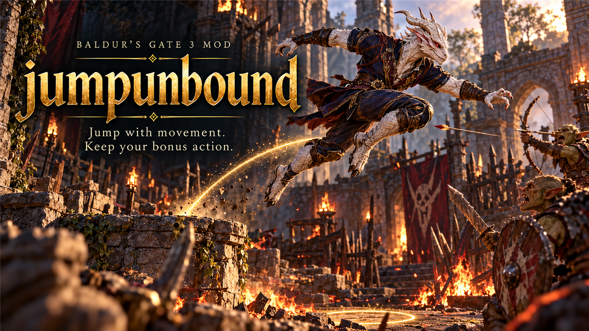

# Jump Unbound

Jumps cost only the movement you use, with a doubled base range. A Mod Configuration Menu switch decides whether Strength still adds to the distance.

## What it does

- Jumping no longer costs a bonus action. A jump costs movement equal to the distance you jump.
- The base jump range is 9 m instead of 4.5 m.
- Strength still adds to the range, as in the base game: 1 m per point of Strength modifier. A switch in the Mod
  Configuration Menu turns this Strength part off; then every character jumps 9 m.

| Strength | Base game | Jump Unbound, Strength on | Jump Unbound, Strength off |
|----------|-----------|---------------------------|----------------------------|
| 10 | 4.5 m | 9 m | 9 m |
| 16 | 7.5 m | 12 m | 9 m |
| 20 | 9.5 m | 14 m | 9 m |

Boosts from spells, items and feats, such as Enhance Leap, still change the range on top of these values.

## Screenshots

## How to install

1. Install [Norbyte's Script Extender](https://github.com/Norbyte/bg3se). It updates itself.
2. Install the [Mod Configuration Menu](https://github.com/KintaroModding/bg3_mcm/releases/latest), version 1.41 or
   later. The official Mod Configuration Menu 1.41 or later works too; keep only one of them.
3. Download `bg3_jumpunbound.pak` from the latest release on GitHub.
4. Copy it to `%LOCALAPPDATA%\Larian Studios\Baldur's Gate 3\Mods`.
5. Enable **Jump Unbound** in your mod manager (BG3 Mod Manager or the in-game mod manager), below the Mod
   Configuration Menu.

To update the mod, replace the `.pak` with the one from the new release. To remove it, disable it in the mod manager
and delete the `.pak`. Saves made with the mod can then show a warning about a missing mod.

## How to use

- Open the Mod Configuration Menu (main menu, Esc menu, or the Insert key) and select **Jump Unbound**. The setting
  **Add Strength to the jump distance** is on by default.
- A change applies at once, also during a game.
- In multiplayer, the host's setting counts for all players.
- The Mod Configuration Menu stores the setting in its profile, not in the savegame.
- The Script Extender console command `!jumpunbound` prints the current jump values.

## Compatibility

- Game version: Patch 8
- Jump Unbound replaces the game's jump (`Projectile_Jump`). Other mods that change this jump conflict with it: the
  mod that loads later wins. Use only one of them.
- Boosts from other mods that change the jump range work on top of Jump Unbound.

## Known issues

- Step of the Wind (Monk) removes the bonus action cost of a jump. With Jump Unbound, a jump has no bonus action cost
  anyway, so Step of the Wind gives no extra benefit for jumps.
- In turn-based mode a jump uses movement, so a long jump needs enough movement left.
- With the Strength switch off, the jump tooltip still says that Strength affects how far you can jump.

## How to build

Anyone can build this mod from its source code and check that the download matches it.

1. Install the tools: Windows PowerShell 5.1 (part of Windows) and [LSLib](https://github.com/Norbyte/lslib/releases)
   v1.20.4. Put LSLib into a folder `_tools\lslib\` above the repository, or set `BG3_TOOLS` to the folder that holds
   `lslib\`.
2. Build it: `powershell -ExecutionPolicy Bypass -File .\build.ps1`
3. Find the file: `dist\bg3_jumpunbound.pak`

The offline tests need Python 3 with lupa: `python -m pip install lupa`, then `python tests\run_tests.py`.

## Credits

Made by Kintaro. MIT license: you may use, change and share this mod.
